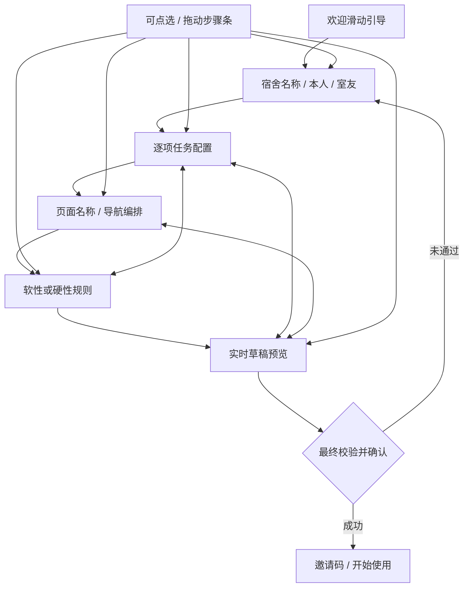

# 新宿舍向导与任务工作台

状态：本地隔离预览；未PR、未合并main、未部署。独立分支codex/new-dorm-wizard-preview。

## 信息架构与流程

一个主题一个步骤。默认四任务槽：地板、厕所、洗手池、抬水；允许改名、停用、移除、补回，最多四项（沿用现有任务域，不承诺任意无限任务）。每项可设置内容、页面归属、大字/卡片、轮换、间隔提示、截止与软硬模式。任务不放日历页，日历固定为完成历史。抬水继续按完成顺序轮换。

## 组件与同步

- DormWizard：步骤、草稿、校验、提交与邀请码；草稿本地保存24小时，不含密码、token。工作台以打开时版本保存，冲突不静默覆盖。
- WizardSteps：方向锁定，点击/拖动跳转；WelcomeSlides：原生横滑和分页指示。
- TaskEditor：单任务配置，复制设置不覆盖任务身份和名称；可删除非强制项。
- LiveDraftPreview：全屏挂载正式 `ChoreBoard`、`ChoreCalendar`、`NewTaskPane`、`ChoreBottomNav` 和 `ScreenStage`；不再维护一份仿制页面。页面、导航和任务展示都来自同一个创建草稿。
- 预览使用合成成员、日期、任务和历史记录，不传入凭证；ChoreBoard 在预览状态从 `load()`、日历统计读取、完成/撤销、催促、推送、消息、AI 与设置入口阻断副作用。拖动正式底栏只重排同一草稿的 `pages`，退出/重进后仍保留。
- TimeWheelSetting：使用项目现有 Vant 时间滚轮；大字时间与滚轮值同步，未引入新时间控件依赖。
- WelcomeGuide：`/guide` 独立全屏四页欢迎引导；登录 App 设置菜单也提供「使用引导」入口。聚光提示以实际 DOM 目标为锚点。
- `localhost`、`127.0.0.1` 等本机地址会在入口页和菜单显示「体验新版创建流程」，并支持 `/?preview=new-dorm` 直达。体验不经过邮箱门禁、使用独立草稿，完成后只显示本地完成提示，不创建宿舍或邀请码；正式域名不显示此入口。
- TaskWorkspace：仅version2的全页配置工作台，复用任务编辑/预览。轮序入口继续使用原SortableMembers。
- NewTaskPane：仅version2任务展示，复用CompletionAction、详情、历史和既有消息/聊天/通知管线。旧四栏管理页不再是新创建完成的过渡目的地。
- SpotlightTour、PermissionPrimer：分步高亮与通知前置说明；此流程没有密码字段，不引入新密码。若出现type=password，向导球球闭眼，失焦恢复。

## 兼容边界

新增dorm_configurations，仅显式新建时原子插入schema_version=2。没有记录的旧宿舍不会被初始化成新版，不变更其进入方式、轮序、历史和页面结构。

迁移0019只新增独立配置表和chore_tasks.completed_by可空字段，不为旧宿舍批量写配置，不覆盖旧记录。新宿舍代做：assignee_id保留原负责人，completed_by为实际操作人；历史展示实际完成者。旧宿舍仍只能完成自己的任务。新配置保存沿用原版本事务，配置与任务设置共同提交。

绿色像素移除是本轮单独授权的展示变化：任务详情、轮次/轮序任务成员行、任务设置名单不再绘制MemberMark；MemberMark组件、资源、数据库marker_id、用户头像、标记选择与颜色变量保留。任务详情改两列，姓名/状态无图标占位。局部姓名字体为系统Rounded/中文圆体优先栈，Medium/Semibold；无字体网络下载，因此无字库许可/加载闪烁或体积增量，但设备没有中文圆体时会回退PingFang等系统字体，不保证所有机型得到相同中文字形。

## 规则

用户确认：软性只提示；硬性按时间完成，允许代做。硬性沿用既有截止/逾期任务模型，不阻止逾期补做。任务级规则可跟随全局或覆盖。间隔提示沿用既有任务间隔提示语义，不擅自新增到期三段邮件或定时通知服务。

新手引导和完成动画与减少动态效果兼容。浏览器回归不等于实体iPhone/Android/Harmony设备验收。

## 本地运行

`node scripts/preview-startup/server.mjs` 后打开 http://127.0.0.1:8094/ 。在设置→账号与宿舍→更多操作→创建宿舍进入向导。后端为临时SQLite与合成邮箱；无生产数据、真实邮件、推送和收费AI。新建后可在该预览的设置中进入任务工作台；刷新可恢复合成新宿舍。
