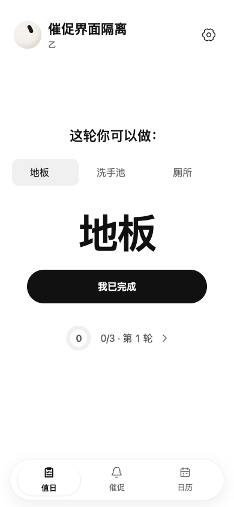
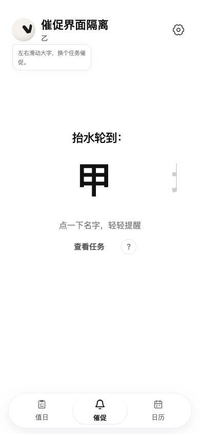
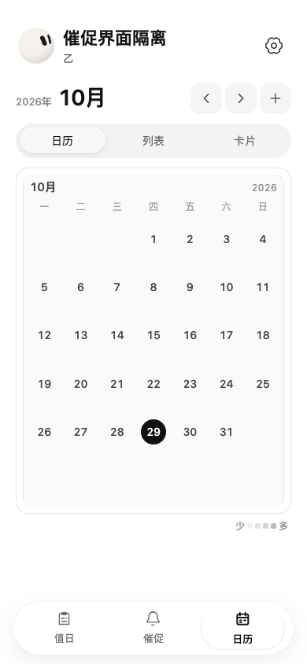
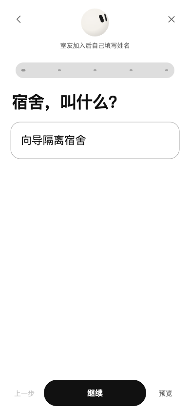
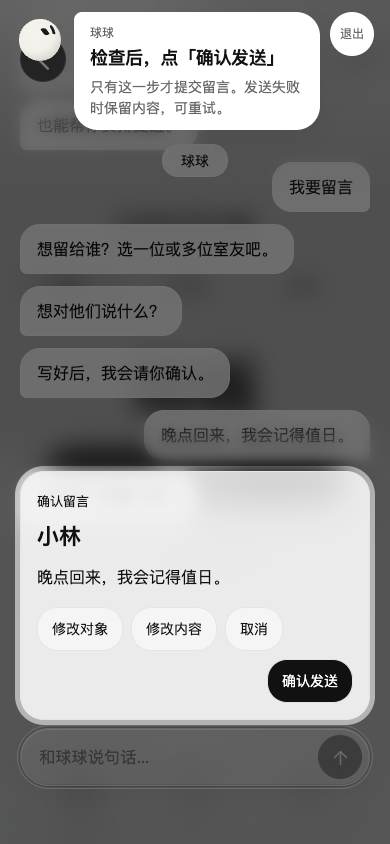

# 轮到：全栈项目展示

轮到面向宿舍共同生活场景，把值日轮次、任务交接、提醒、日历和留言放进一个移动优先的应用。项目展示的重点是：**如何让多用户操作有明确权限、让状态变化可回溯，并把可交互预览与真实业务数据隔离**。

前端采用 Vue 3、TypeScript、Pinia 和 Vue Router；当前正式服务链路为 Node.js、业务 API 与 SQLite。代码库也保留 Android 和 HarmonyOS 工程，平台表现不能由网页模拟结果代替。

| 值日与轮次 | 催促与任务交接 | 完成日历 |
| --- | --- | --- |
|  |  |  |

| 宿舍创建 | 交互式教程中的留言练习 |
| --- | --- |
|  |  |

以上图片来自本地隔离测试，宿舍与成员为合成数据；为桌面浏览器模拟手机尺寸，不代表真机测试。

- [可编辑的全栈简历描述](resume.md)
- [架构与关键技术决策](architecture.md)
- [面试问题与证据指引](interview.md)
- [演示步骤与录屏脚本](demo.md)
- [验证结果和球球事实测试矩阵](verification.md)

这些材料是基于当前代码的项目介绍。个人职责、项目时间、实际用户数等需由本人根据事实填写；未测量的指标不应写成成果。
