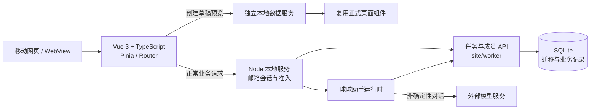

# 架构与技术决策

以下说明以 `aafe9bd65d19f9a46fccc707f68b6bd741e203d5` 的产品代码为基准；后续提交可能改变实现。历史 `backend/` FastAPI 代码并非 README 所描述的当前正式部署入口。

## 真实业务与预览分离

真实页面经 API 修改业务状态；创建向导的预览通过 `localBoardServiceKey` 注入本地数据服务，并复用正式页面组件。预览交互只处理草稿/模拟数据，不能把它描述为“用正式数据库做演示”。关键位置：`frontend/src/components/onboarding/LiveDraftPreview.vue`、`frontend/src/interaction/localBoardService.ts`。

## 多成员状态与请求重试

不同任务支持全员轮次、按时间安排或完成后交接。身份和权限由服务端判断，不能只依赖页面按钮的显示状态。创建请求使用 `request_id` 与邮箱账号上下文，在重试时核对同一请求参数；具体边界和冲突响应以 `site/worker/backend.mjs` 与 `site/scripts/check-room-creation-idempotency.mjs` 为准。不要把有限范围的幂等行为夸大为全系统“绝对不会重复”或分布式 exactly-once。

## 助手如何回答事实问题

球球对身份、当前任务等可识别问题使用认证后的业务上下文，读取最新状态并优先走确定性回复；其他问题可交给外部模型。提醒等具有副作用的操作需要遵循已有确认与限流逻辑。其效果应以隔离测试中的具体案例描述，不代表所有自然语言问题都准确，也不代表真实模型调用已测试。

## 验证边界

浏览器自动化用于检查交互与状态，隔离测试使用本地临时数据库及模拟服务。iPhone Safari、Android WebView、HarmonyOS ArkWeb 的真实键盘、触摸和性能仍需各自真机验证。
